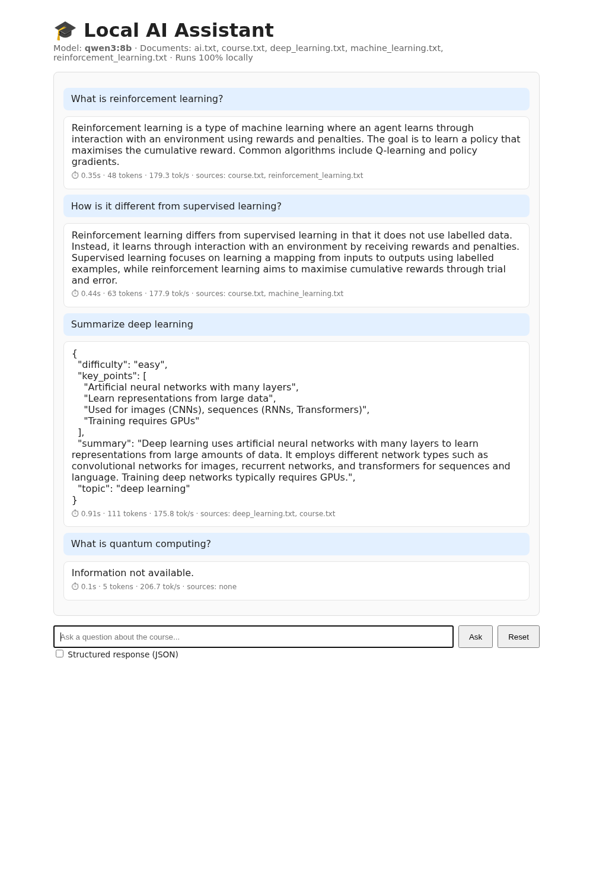

# Local AI with Ollama

Practical lab: running and developing local AI applications with **Ollama**: a local LLM through the REST API, prompt engineering, model comparison, a chatbot with memory, structured (JSON) output, a mini-RAG, local vision, a Flask web app and a benchmark.

**Main deliverable:** [`local_ai_ollama_lab.ipynb`](local_ai_ollama_lab.ipynb). It contains all the code and outputs, plus the answers to every question.
**Report:** [`LocalAI_Lab/report.pdf`](LocalAI_Lab/report.pdf). It has the screenshots, the exercise answers and Q1–Q15.

## Deliverables

| Item | Where |
|---|---|
| Notebook (code, outputs, answers) | `local_ai_ollama_lab.ipynb` |
| Report | `LocalAI_Lab/report.pdf` |
| Final project source | `LocalAI_Lab/source/`: `app.py`, `chatbot.py`, `rag.py`, `benchmark.py`, `templates/` |
| Course documents (RAG knowledge) | `LocalAI_Lab/documents/` |
| Screenshots | `LocalAI_Lab/screenshots/01_installation.png` … `06_webapp.png` |
| Python client (Ex 8) | `local_ai_lab/` |
| Simple web app (Part 15) | `local-ai-web/` |



## Models (Ollama 0.12.6, single 32 GB NVIDIA GPU, 100 % GPU)

| Role | Model | Size | Speed |
|---|---|---|---|
| Model 1 | `qwen3:8b` (Q4_K_M, thinking) | 5.2 GB | ~173 tok/s |
| Model 2 | `llama3.2:3b` (Q4_K_M) | 2.0 GB | ~286 tok/s |
| Vision | `qwen2.5vl:7b` | 6.0 GB | |
| Embeddings | `nomic-embed-text` | 0.3 GB | |

The statement suggests `qwen3.5` / `gemma3`. Their current builds need a newer Ollama than the installed one, so the closest supported models are used. Generation uses a fixed seed (`seed=42`).

## Setup and run

```bash
ollama pull qwen3:8b && ollama pull llama3.2:3b && ollama pull qwen2.5vl:7b && ollama pull nomic-embed-text
python -m venv .venv && source .venv/bin/activate && pip install -r requirements.txt
jupyter lab local_ai_ollama_lab.ipynb

# final project
cd LocalAI_Lab/source && python app.py      # http://127.0.0.1:5001
```

`image.jpg` is from COCO val2017 (#266400, CC BY-NC-SA).
